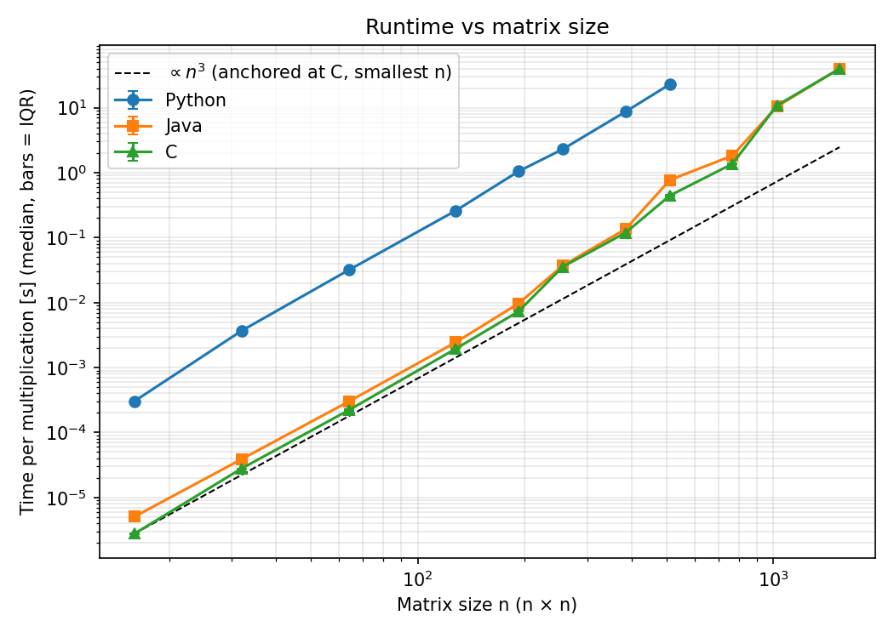
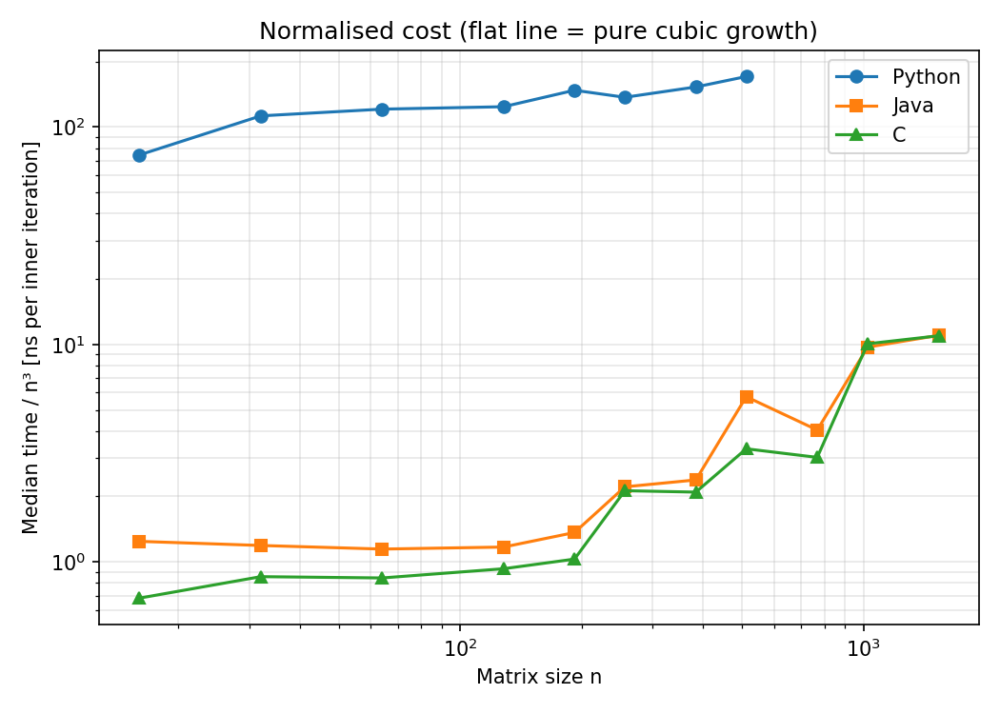
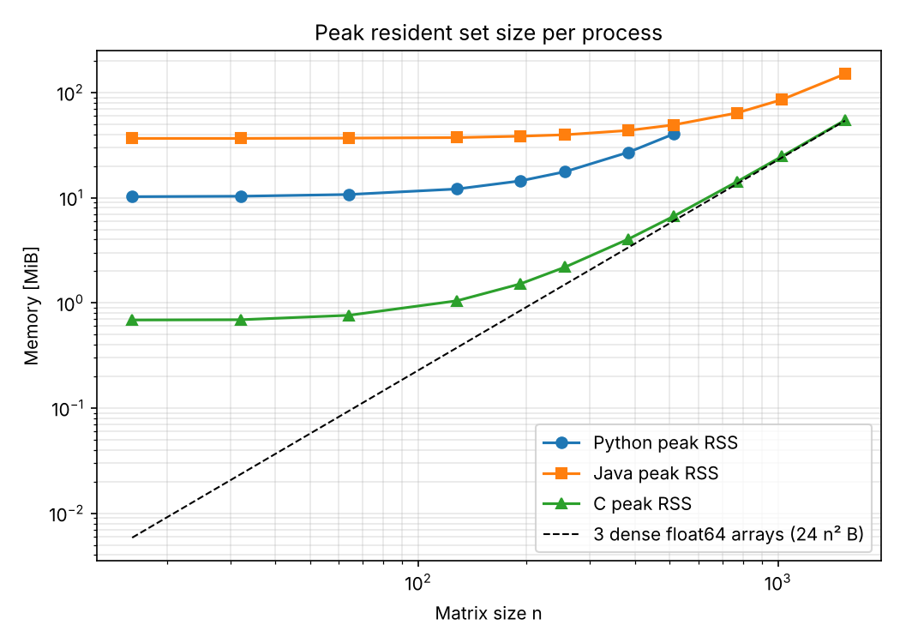
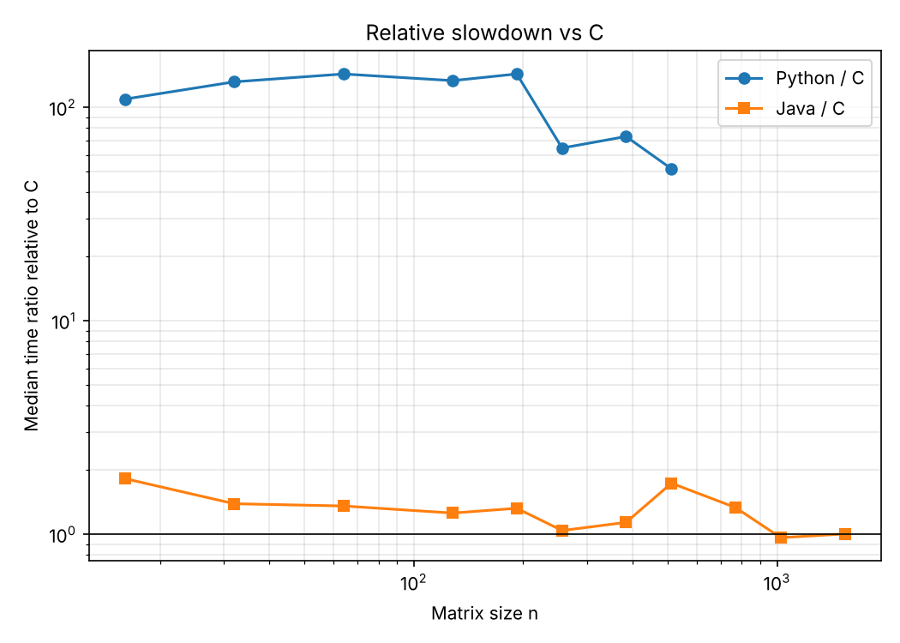

# Abstract

I measured how the matrix size *n* affects the runtime and peak memory of the same i-j-k
triple-loop matrix multiplication written in Python, Java and C. The three programs read the
same float64 input files, give bitwise-identical results, and are timed over the kernel
only, all on one laptop (Intel Core i5-5350U, 2 cores, 8 GB RAM, macOS). For small matrices the runtime grows roughly as n³ (fitted exponents of 3.0 to 3.3 for
n ≤ 192). Between
n = 16 and n = 1536, however, the cost of each inner iteration rises about 16 times for C and
9 times for Java, so a single fit over n ≥ 128 gives an exponent close to 4. Java is 1.3 to
1.8 times slower than C on small matrices and takes the same time as C for n ≥ 1024, where
both seem to be limited by memory access. CPython is 110 to 145 times slower than C while the
data fit in cache, and 52 to 73 times slower for n = 256 to 512. With a budget of 60 s per
repetition, the largest size that finished was n = 512 for Python and n = 1536 for Java and
C. These results apply to the tested implementations, settings and machine.

# 1. Introduction and objective

Dense matrix multiplication appears in many data-science workloads, and its basic algorithm
is short and O(n³). That makes it a good test case for seeing how the language runtime and
the memory hierarchy affect performance.

**Research question.** How does the matrix size *n* affect the runtime and memory use of
the same basic triple-loop multiplication implemented in Python, Java and C, under the
documented conditions on one machine?

**Hypotheses** (written before running the study):

* H1: runtime grows approximately as n³ for all three implementations.
* H2: C and Java (JIT-compiled to native code) stay within a small factor of each other,
  while CPython is one to two orders of magnitude slower.
* H3: the time per inner iteration (t/n³) increases once the matrices no longer fit in
  cache, because the inner loop reads B column by column with a stride of 8n bytes.
* H4: peak memory grows as n², with a higher cost per element for Python (boxed floats)
  and a larger fixed offset for Java (the JVM).

# 2. Background

The classical algorithm computes each of the n² output entries as a dot product of length n,
which gives n³ multiply-add pairs, or 2n³ floating-point operations. On real hardware the
runtime also depends on how memory is accessed. In the i-j-k order, A is read along a row
(unit stride) and B down a column (stride of n elements). Column access has poor spatial
locality and causes cache and TLB misses once B no longer fits in the caches [1], [2].
High-performance libraries avoid this with blocking and packing [3]. I did not use those
optimisations here; they belong to Assignment 2.

CPython runs bytecode in an interpreter and stores each float as a separate object on the
heap, so every arithmetic operation carries a large overhead. The HotSpot JIT compiles Java
bytecode while the program runs, so warm-up runs have to be kept apart from the
steady-state measurements [4]. C is compiled ahead of time.

The rounding error of a floating-point dot product of length n is bounded by γₙ|a|ᵀ|b|,
with γₙ = nu/(1−nu) and u = 2⁻⁵³ [5]. I used this bound to set the correctness tolerance.

# 3. Methodology

## 3.1 Implementations

The three programs run the same loop nest on row-major storage:

```
for i in 0..n-1:
    for j in 0..n-1:
        s = 0.0
        for k in 0..n-1: s += A[i*n+k] * B[k*n+j]
        C[i*n+j] = s
```

| | Python | Java | C |
|---|---|---|---|
| Storage | flat `list` of Python `float` objects (pointers to boxed doubles) | contiguous `double[]` | contiguous `double*` (`malloc`) |
| Toolchain | CPython 3.13.5 (Anaconda) | OpenJDK 21.0.6 (JetBrains Runtime), `javac --release 17` | Apple clang 14.0.0 (invoked as `gcc`) |
| Settings | no NumPy in the kernel; 1 warm-up | `-XX:+UseSerialGC -Xms256m -Xmx4g`; 3 warm-ups | `-O2 -std=c11 -ffp-contract=off`; 1 warm-up |

The one difference I could not avoid is storage: the Python list holds pointers to separate
float objects instead of contiguous doubles. In C, `-ffp-contract=off` stops the compiler
from fusing a multiply and an add into one instruction, so all three programs perform the
same IEEE-754 operations in the same order. Java 17 and later follow strict IEEE-754
semantics and do not fuse operations on their own.

## 3.2 Inputs

The inputs are square float64 matrices with values drawn uniformly from [−1, 1).
`scripts/gen_matrices.py` generates them once with Python's `random.Random` (Mersenne
Twister), using the string seed `20262027:n:A` or `20262027:n:B`, and saves them as raw
little-endian binary files. All three languages read these same files, so the inputs are
identical across methods. `inputs/manifest.csv` records the SHA-256 hash of every file.

The declared sizes were n = 16, 32, 64, 128, 192, 256, 384, 512, 768, 1024, 1536 and 2048. I
mixed powers of two with intermediate values so the plots would show the general trend and
any effect specific to powers of two.

## 3.3 Environment

| Item | Value |
|---|---|
| Machine | MacBook Air (Intel), run on 2026-10-08 |
| CPU | Intel(R) Core(TM) i5-5350U CPU @ 1.80GHz (Broadwell-U, 1.8 GHz base, 2.9 GHz turbo) |
| Cores | 2 physical cores, 4 logical processors |
| Caches [6] | L1d 32 KB and L2 256 KB per core, L3 3 MB shared |
| RAM | 8 GiB |
| OS | macOS, Darwin kernel 21.6.0 (x86_64) |
| Python | CPython 3.13.5 (Anaconda); NumPy 2.1.3 for validation only |
| Java | OpenJDK 21.0.6 (JetBrains Runtime), options `-XX:+UseSerialGC -Xms256m -Xmx4g` |
| C compiler | Apple clang version 14.0.0 (clang-1400.0.29.202), flags `-O2 -std=c11 -ffp-contract=off` |

Every kernel runs on a single thread. The JVM also starts its own internal threads (JIT
compiler, serial GC, housekeeping), while CPython uses one. The laptop was plugged in and I
was not using any other application during the runs. macOS does not let you set CPU affinity
or see the frequency governor, so Turbo Boost stayed on and I could not control it.

## 3.4 Correctness

`tests/validate.py` runs two groups of checks. The first uses small integers, which are
exactly representable in float64, so the result has to match exactly: a 2×2 product worked
out by hand, a 1×1 case, A·I = A, I·B = B, A·0 = 0, and random integer matrices up to
n = 17. The second compares random float64 matrices (n = 2 to 128) with NumPy 2.1.3, used as
a trusted reference. A result passes when |C − C_ref| ≤ 2γₙ(|A||B|) for every entry.

All 63 checks passed (`results/validation_report.txt`). The largest error was 7.1·10⁻¹⁵ at
n = 128, which is 0.7 % of the bound, and the three languages gave bitwise-identical outputs
in every random case. During the benchmark each program also printed a checksum (the
sequential sum of C) after every repetition. The checksums matched across languages and
repetitions for every n, so the multiplication really ran each time.

## 3.5 Measurement protocol

Only the kernel (the three loops) is timed. Loading the inputs, allocating C, computing the
checksum and writing output all happen outside the timer. C does not need to be filled with
zeros first, because every entry is written exactly once. Each language uses a monotonic
nanosecond timer: `time.perf_counter_ns`, `System.nanoTime` and
`clock_gettime(CLOCK_MONOTONIC)`.

Small matrices finish in microseconds, so for them one sample times
`max(1, round(2·10⁷/n³))` multiplications in a row (4883 at n = 16, and 1 for n ≥ 256). The
batch size is the same in all languages, and the reported times are per multiplication.

For each language and size, one process runs W warm-ups (1 in Python, 3 in Java, 1 in C)
and then 5 measured repetitions. The warm-ups are saved in the raw CSV but left out of the
statistics. The order of the languages is shuffled for each size with a fixed seed, to limit
bias from drift over time. I report the median and interquartile range (IQR) of the 5
repetitions. The empirical exponent b is the least-squares slope of log t = a + b log n.

Memory is the peak resident set size (RSS) of the whole process, which includes the
interpreter or the JVM. On macOS this is the child's `ru_maxrss`, read with `os.wait4`. For
Java I also recorded the heap in use at the end of the run. In theory the three arrays take
24n² bytes.

Before running anything I set two budgets: 60 s per repetition, enforced as a process limit
of (W + 5)·60 s + 30 s, and 4 GB of memory. After a timeout, larger sizes were skipped for
that language.

# 4. Results

The raw data are in `results/run_20261008-202121/`. The tables and figures come from
`python3 scripts/analyze.py results/run_20261008-202121`.

**Table 1.** Time per multiplication (median of 5 repetitions), relative spread, cost per
inner iteration (median / n³), throughput, ratio to C and peak RSS.

| Method | n | Median | IQR/median | ns/iter | GFLOP/s | ×C | Peak RSS (MiB) |
|---|--:|--:|--:|--:|--:|--:|--:|
| Python | 16 | 304.8 µs | 4.4 % | 74.41 | 0.027 | 109.3 | 10.2 |
| Python | 32 | 3.69 ms | 1.5 % | 112.56 | 0.018 | 131.7 | 10.3 |
| Python | 64 | 31.69 ms | 3.9 % | 120.88 | 0.017 | 143.4 | 10.7 |
| Python | 128 | 260.10 ms | 1.2 % | 124.02 | 0.016 | 133.5 | 12.1 |
| Python | 192 | 1.04 s | 2.9 % | 147.63 | 0.014 | 143.5 | 14.4 |
| Python | 256 | 2.30 s | 1.5 % | 137.02 | 0.015 | 64.5 | 17.7 |
| Python | 384 | 8.66 s | 0.8 % | 152.89 | 0.013 | 73.1 | 27.1 |
| Python | 512 | 22.92 s | 1.2 % | 170.74 | 0.012 | 51.6 | 40.3 |
| Java | 16 | 5.1 µs | 0.6 % | 1.24 | 1.610 | 1.8 | 36.6 |
| Java | 32 | 39.0 µs | 0.4 % | 1.19 | 1.682 | 1.4 | 36.6 |
| Java | 64 | 300.0 µs | 1.0 % | 1.14 | 1.748 | 1.4 | 36.9 |
| Java | 128 | 2.45 ms | 0.8 % | 1.17 | 1.711 | 1.3 | 37.3 |
| Java | 192 | 9.65 ms | 0.6 % | 1.36 | 1.467 | 1.3 | 38.4 |
| Java | 256 | 37.12 ms | 0.6 % | 2.21 | 0.904 | 1.0 | 39.7 |
| Java | 384 | 134.79 ms | 4.8 % | 2.38 | 0.840 | 1.1 | 43.6 |
| Java | 512 | 771.36 ms | 10.1 % | 5.75 | 0.348 | 1.7 | 49.2 |
| Java | 768 | 1.83 s | 1.4 % | 4.04 | 0.495 | 1.3 | 63.9 |
| Java | 1024 | 10.43 s | 1.6 % | 9.72 | 0.206 | 1.0 | 85.5 |
| Java | 1536 | 39.90 s | 1.1 % | 11.01 | 0.182 | 1.0 | 150.1 |
| C | 16 | 2.8 µs | 5.3 % | 0.68 | 2.938 | 1.0 | 0.7 |
| C | 32 | 28.0 µs | 2.6 % | 0.85 | 2.341 | 1.0 | 0.7 |
| C | 64 | 220.9 µs | 4.6 % | 0.84 | 2.373 | 1.0 | 0.8 |
| C | 128 | 1.95 ms | 9.9 % | 0.93 | 2.152 | 1.0 | 1.0 |
| C | 192 | 7.28 ms | 3.4 % | 1.03 | 1.943 | 1.0 | 1.5 |
| C | 256 | 35.63 ms | 1.2 % | 2.12 | 0.942 | 1.0 | 2.2 |
| C | 384 | 118.47 ms | 12.7 % | 2.09 | 0.956 | 1.0 | 4.1 |
| C | 512 | 444.32 ms | 7.5 % | 3.31 | 0.604 | 1.0 | 6.7 |
| C | 768 | 1.37 s | 0.6 % | 3.02 | 0.662 | 1.0 | 14.2 |
| C | 1024 | 10.81 s | 4.4 % | 10.07 | 0.199 | 1.0 | 24.7 |
| C | 1536 | 39.72 s | 0.7 % | 10.96 | 0.182 | 1.0 | 54.7 |

**Table 2.** Empirical growth exponent b from a least-squares fit on log-log axes, over the
predefined range n ≥ 128 and separately over three ranges of sizes.

| Method | n ≥ 128 | n 16–192 | n 256–768 | n 1024–1536 |
|---|--:|--:|--:|--:|
| Python | 3.20 | 3.23 | 3.31 (n ≤ 512) | – |
| Java | 3.95 | 3.02 | 3.71  | 3.31 |
| C | 4.02 | 3.14 | 3.40  | 3.21 |

**Table 3.** Largest size that finished within the declared budgets, and the failures.

| Method | Largest feasible n | Largest attempted n | Failures |
|---|---|---|---|
| Python | 512 | 768 | n=768: timeout (limit 390 s) |
| Java | 1536 | 2048 | n=2048: timeout (limit 510 s) |
| C | 1536 | 2048 | n=2048: timeout (limit 390 s) |

**Table 3b.** Repetitions that finished before the process limit was reached. Each one took
longer than the 60 s budget, so none of them enter the statistics.

| Method | n | warm-ups done | measured reps done | time per completed rep [s] |
|---|---|---|---|---|
| C | 2048 | 1 | 2 | 104.2, 104.1 |
| Java | 2048 | 3 | 2 | 99.3, 98.2 |
| Python | 768 | 1 | 3 | 79.3, 79.9, 78.4 |

**Table 4.** JIT warm-up in Java: the first and last warm-up run divided by the median of
the measured repetitions.

| Method | n | first warm-up / median | last warm-up / median |
|---|---|---|---|
| Java | 16 | 1.80 | 1.00 |
| Java | 32 | 1.82 | 1.01 |
| Java | 64 | 1.95 | 1.00 |
| Java | 128 | 1.63 | 0.99 |
| Java | 192 | 1.38 | 0.92 |
| Java | 256 | 1.44 | 1.03 |
| Java | 384 | 1.17 | 0.96 |
| Java | 512 | 0.84 | 1.11 |
| Java | 768 | 0.99 | 1.02 |
| Java | 1024 | 1.24 | 1.00 |
| Java | 1536 | 1.00 | 1.00 |

{width=80%}

{width=80%}

{width=80%}

{width=80%}

# 5. Discussion

## Growth with n (H1, partly supported)

For small matrices the growth is close to cubic. For n ≤ 192 the fitted exponents are 3.02
for Java, 3.14 for C and 3.23 for Python. Between n = 256 and 768 they rise to 3.40 for C and
3.71 for Java, because that range contains the jump at n = 512, and for n = 1024 and 1536
they are 3.21 and 3.31. Over the predefined range n ≥ 128,
however, C and Java give b ≈ 4.0. The algorithm still does exactly n³ multiply-add pairs;
what changes is the cost of each one (Fig. 2). For C it is 0.68 to 1.03 ns for n ≤ 192,
about 2.1 ns for n = 256 and 384, 3.0 to 3.3 ns for n = 512 and 768, and 10 to 11 ns for
n = 1024 and 1536. So the cubic model predicts the operation count correctly, and the
constant in front of n³ depends on which level of the memory hierarchy holds the data.

## Memory hierarchy (H3, supported; the exact mechanism is a hypothesis)

The steps in Fig. 2 line up with the column-wise reads of B. The first step, between
n = 192 and n = 256, is where B (8n² bytes, growing from 288 KiB to 512 KiB) becomes larger
than the 256 KB L2 cache of each core [6]. The biggest step, at n = 1024, is where B alone
(8 MiB) is far larger than the 3 MB L3 cache, so most reads have to go to DRAM. Two
observations point to more than a plain capacity effect:

* n = 512 costs more per iteration than the larger n = 768, both in C (3.31 vs 3.02 ns) and
  in Java (5.75 vs 4.04 ns). At n = 512 the column stride is exactly 4096 bytes, and
  power-of-two strides are known to send many accesses to the same cache sets, which causes
  conflict misses [2].
* For n ≥ 512 every step down a column lands on a new 4 KiB page, so TLB misses probably
  add to the cost as well.

I did not have hardware performance counters, so I cannot separate these causes. They fit
the data, but I did not measure them directly.

## Java versus C (H2, supported)

After warm-up, Java is 1.3 to 1.8 times slower than C for n ≤ 192, and 1.0 to 1.3 times
slower for n = 256 to 768 (with 1.7 at n = 512). At n = 1024 and 1536 the two take the same
time, around 0.18 to 0.21 GFLOP/s. This fits a memory-bound kernel: once most of the time is
spent waiting for B, the quality of the generated code has little effect. The gap at small n
may come from differences in the machine code, such as array bounds checks in Java, but I
did not inspect the JIT output. Table 4 shows how much warm-up matters. At small n the first
Java warm-up took 1.4 to 1.95 times longer than the steady state, while the third was within
a few percent of it. The Java result at n = 512 is an outlier (ratio 1.7, IQR/median of
10 %, and warm-ups that got slower), and I have no evidence that explains it.

## Python (H2, supported)

CPython needs 74 to 171 ns per inner iteration, against about 1 ns for C while the data are
in cache. That makes it 110 to 145 times slower than C for n ≤ 192 and 52 to 73 times slower
for n = 256 to 512. The ratio drops because C slows down sharply once memory becomes the
bottleneck, while Python's cost per iteration comes mostly from interpreting bytecode and
handling objects. Between n = 16 and 512 that cost grows 2.3 times, against 4.9 times for C.
Python's own exponent over n = 128 to 512 is 3.20.

## Memory (H4, supported)

The peak RSS of C is almost exactly the array storage: 54.7 MiB at n = 1536, against
54.0 MiB for three float64 arrays. Java adds a fixed 36 MiB or so for the JVM, and at
n = 1536 it uses about 17 bytes per matrix element. The extra bytes are probably the input
buffers, which stay alive until the garbage collector frees them; the heap in use at the end
of the run was 79 MB. Python starts at about 10 MiB and needs about 40 bytes per element at
n = 512 (40.3 MiB in total). That matches an 8-byte pointer in the list plus a 24-byte float
object for each element, plus temporary buffers used while loading. Memory never limited the
study: the largest process used 241 MB, well under the 4 GB budget.

## Limits

The largest feasible size was set by the time budget. Python at n = 768 needed about 79 s per
repetition, and C and Java at n = 2048 about 98 to 104 s (Table 3b). I report these partial
repetitions, but they are not used in any statistic. Following the cubic trend, one Python
repetition at n = 1536 would take 10 minutes or more. That figure is an extrapolation; I did
not run it.

## Variability and validity

IQR/median was under 5 % in 25 of the 30 configurations, with a maximum of 12.7 % (C,
n = 384). I did not remove any observation. The main threats to validity are:

* everything ran on one laptop, without control over Turbo Boost or temperature, and macOS
  does not allow pinning a process to a core;
* each configuration ran in a single process, so the variation between separate launches is
  not captured;
* the memory metric includes each language's runtime, so it measures slightly different
  things in each language;
* the sizes are far apart, so the exact position of each step is not known.

These results describe three simple implementations on this machine. They do not show that
one language is faster in general.

# 6. Conclusions

For the tested i-j-k implementations, runtime grows close to n³ only for small matrices
(n ≤ 192). Between small matrices and n ≥ 1024 the cost per inner iteration grows about
16 times for C and 9 times for Java, so the effective exponent over n = 128 to 1536 is close
to 4. C and Java behave alike: Java is 1.3 to 1.8 times slower while the data fit in cache,
and as fast as C on large matrices. CPython is roughly 50 to 145 times slower than C,
depending on n. Memory grows as n² in all three, at about 8, 17 and 40 bytes per element for
C, Java and Python, and it was never the limiting resource.

My own computer also shaped how the study went. It is a fairly old laptop, with a 2015
generation 15 W dual-core processor, a 3 MB last-level cache and 8 GB of DDR3 memory, and it
struggles with dense, long-running jobs like these. One repetition took about 40 s for C and
Java at n = 1536 and about 23 s for Python at n = 512. The whole study took about 40 minutes,
and the largest sizes (Python at n = 768, C and Java at n = 2048) went over the 60 s budget
per repetition. The small caches also explain why the cost per iteration starts rising at
fairly moderate sizes. A newer computer would give lower times and could run larger sizes,
so the absolute values and size limits in this report belong to this laptop. What the study
supports is the relative behaviour: the cubic operation count, the growing cost of memory
access, Java converging to C, and the interpretation overhead of Python. Checking it on
other hardware is still pending.

Two questions remain open. The first is how much of the cost at large n comes from cache
conflicts, cache capacity and TLB misses; hardware counters, or the unit-stride i-k-j order
and blocking from Assignment 2, could separate them. The second is how the kernel scales
across threads, which is the subject of Assignment 3.

# Use of generative AI

I used Claude (Anthropic) throughout this assignment: to help with the design of the
experiment, to explain the topic so I could learn it, to help me develop the code (it
generated the first versions of the three implementations and of the benchmarking and
analysis scripts), and to draft the report from my results. I ran all the experiments on my
own computer, fixed the problems that came up when running them on macOS, and reviewed the
code and the text. Every number here comes from those runs, and I can explain and defend
the conclusions.

# References

[1] J. L. Hennessy and D. A. Patterson, *Computer Architecture: A Quantitative Approach*, 6th ed. Cambridge, MA, USA: Morgan Kaufmann, 2017.

[2] U. Drepper, "What every programmer should know about memory," Red Hat, Inc., Tech. Rep., 2007.

[3] K. Goto and R. A. van de Geijn, "Anatomy of high-performance matrix multiplication," *ACM Trans. Math. Softw.*, vol. 34, no. 3, Art. 12, 2008.

[4] A. Georges, D. Buytaert, and L. Eeckhout, "Statistically rigorous Java performance evaluation," in *Proc. OOPSLA*, 2007, pp. 57–76.

[5] N. J. Higham, *Accuracy and Stability of Numerical Algorithms*, 2nd ed. Philadelphia, PA, USA: SIAM, 2002.

[6] TechPowerUp, "Intel Core i5-5350U," CPU Database. [Online]. Available: https://www.techpowerup.com/cpu-specs/core-i5-5350u.c1812

**Reproducibility materials.** The code and data are in the GitHub repository
https://github.com/amaisuarez/assignment1. The study was run from commit `ffcf45a`, and the
raw data are in `results/run_20261008-202121/`.
